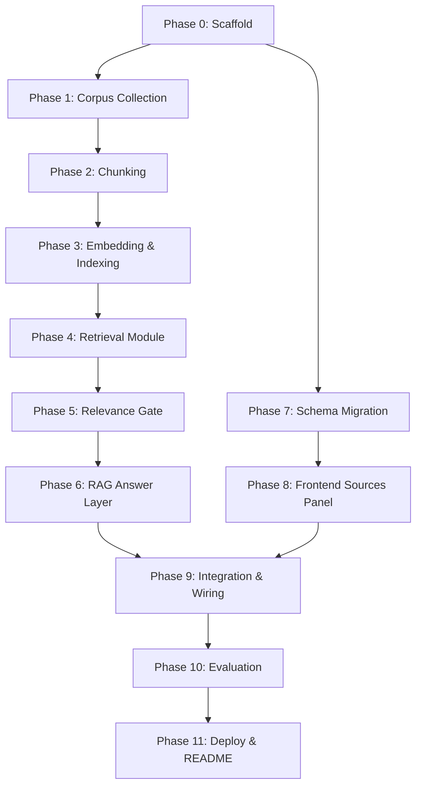

# Implementation Plan — Milestone 2 Dietary Guidance RAG Chatbot

> **Reference documents:**
> - [problemStatement.md](file:///Users/bhavyachadha/Desktop/Milestone%202%20Nutrition%20Bot/problemStatement.md) — what to build and why
> - [architecture.md](file:///Users/bhavyachadha/Desktop/Milestone%202%20Nutrition%20Bot/architecture.md) — how it's structured

---

## Phase Overview

| Phase | Name | Delivers | Estimated Effort |
|-------|------|----------|-----------------|
| **0** | Project Scaffold | Directory structure, deps, env, DB tables | 1–2 hours |
| **1** | Corpus Collection | 7 documents downloaded, parsed, metadata stored | 2–3 hours |
| **2** | Chunking Pipeline | Section-aware chunks with metadata, stored in DB | 2–3 hours |
| **3** | Embedding & Indexing | Chunks embedded, pgvector index live, sanity-checked | 1–2 hours |
| **4** | Retrieval Module | `retriever.ts` + Local Math, per-doc filtering | 1–2 hours |
| **5** | Relevance Gate & Refusal | Corpus-miss detection, two refusal paths working | 1–2 hours |
| **6** | RAG Answer Layer | Prompt builder + LLM call + Zod parse, end-to-end | 2–3 hours |
| **7** | Schema Migration | `source: null` → `Citation` object, Zod updated | 1 hour |
| **8** | Frontend: Sources Panel | `SourcesPanel` + `SourceCard` populated, claims linked | 2–3 hours |
| **9** | Integration & Wiring | Full pipeline connected, session context, error states | 2–3 hours |
| **10** | Evaluation | Question bank, hit-rate, M1 comparison, citation spot-check | 3–4 hours |
| **11** | Deploy & README | Vercel deploy, README with config table, final smoke tests | 1–2 hours |

**Total estimated effort: 19–30 hours**

---

## Phase 0 — Project Scaffold

### Goal
Set up the directory structure, install new dependencies, configure environment variables, and create the M2 database tables.

### Steps

#### 0.1 Create Directory Structure

```bash
# From project root (nutrition-bot/)
mkdir -p corpus/raw corpus/parsed scripts eval/results
```

New directories:
- `corpus/raw/` — original PDF/HTML files
- `corpus/parsed/` — extracted plain text per document
- `scripts/` — offline pipeline scripts (parse, chunk, embed)
- `eval/results/` — evaluation output files

#### 0.2 Install New Dependencies

```bash
# Python deps (for offline pipeline scripts)
pip install pymupdf beautifulsoup4 requests tiktoken sentence-transformers python-dotenv chromadb

# Node deps (for runtime retrieval)
npm install chromadb @xenova/transformers
# Chroma DB is used for vector storage; Transformers.js for local query embedding
```

#### 0.3 Environment Variables

Add to `.env.local`:

```bash
# --- M2 additions ---
# RAG Configuration
EMBEDDING_MODEL=jinaai/jina-embeddings-v2-small-en
EMBEDDING_DIMENSIONS=512
CHUNK_SIZE=800
CHUNK_OVERLAP=100
RETRIEVAL_K=6
RELEVANCE_THRESHOLD=0.45
```

#### 0.4 Create M2 Database Tables

Run in SQLite via db.ts:

```sql
-- Document metadata table
CREATE TABLE documents (
  doc_id          TEXT PRIMARY KEY,
  document_name   TEXT NOT NULL,
  publisher       TEXT NOT NULL,
  year            INT  NOT NULL,
  source_url      TEXT NOT NULL,
  retrieval_date  DATE NOT NULL,
  doc_type        TEXT CHECK (doc_type IN ('nutrition', 'food_safety'))
);

-- Note: Chunks and embeddings are stored in Chroma DB, not SQLite.
```

#### 0.5 Create `corpus/metadata.json`

```json
[
  {
    "doc_id": "usda-dga-2020",
    "document_name": "Dietary Guidelines for Americans, 2020–2025",
    "publisher": "USDA & HHS",
    "year": 2020,
    "source_url": "https://odphp.health.gov/our-work/nutrition-physical-activity/dietary-guidelines",
    "doc_type": "nutrition",
    "filename": "usda-dietary-guidelines.pdf"
  },
  {
    "doc_id": "who-healthy-diet",
    "document_name": "Healthy Diet Fact Sheet",
    "publisher": "World Health Organization (WHO)",
    "year": 2024,
    "source_url": "https://www.who.int/news-room/fact-sheets/detail/healthy-diet",
    "doc_type": "nutrition",
    "filename": "who-healthy-diet.html"
  },
  {
    "doc_id": "uk-eatwell-2016",
    "document_name": "The Eatwell Guide",
    "publisher": "Public Health England (UK Gov)",
    "year": 2016,
    "source_url": "https://www.gov.uk/government/publications/the-eatwell-guide",
    "doc_type": "nutrition",
    "filename": "uk-eatwell-guide.pdf"
  },
  {
    "doc_id": "efsa-drv-2017",
    "document_name": "Dietary Reference Values — Summary Report",
    "publisher": "European Food Safety Authority (EFSA)",
    "year": 2017,
    "source_url": "https://www.efsa.europa.eu/en/supporting/pub/e15121",
    "doc_type": "nutrition",
    "filename": "efsa-drv-summary.pdf"
  },
  {
    "doc_id": "foodsafety-cold-storage",
    "document_name": "Cold Food Storage Charts",
    "publisher": "FoodSafety.gov (USDA / FDA / CDC)",
    "year": 2024,
    "source_url": "https://www.foodsafety.gov/food-safety-charts/cold-food-storage-charts",
    "doc_type": "food_safety",
    "filename": "foodsafety-cold-storage.html"
  },
  {
    "doc_id": "au-dietary-2013",
    "document_name": "Australian Dietary Guidelines",
    "publisher": "NHMRC",
    "year": 2013,
    "source_url": "https://www.eatforhealth.gov.au/guidelines",
    "doc_type": "nutrition",
    "filename": "au-dietary-guidelines.pdf"
  },
  {
    "doc_id": "fda-food-code-2022",
    "document_name": "FDA Food Code",
    "publisher": "U.S. Food & Drug Administration (FDA)",
    "year": 2022,
    "source_url": "https://www.fda.gov/food/retail-food-protection/fda-food-code",
    "doc_type": "food_safety",
    "filename": "fda-food-code.pdf"
  }
]
```

### ✅ Exit Criteria — Phase 0

- [ ] Directory structure exists: `corpus/raw/`, `corpus/parsed/`, `scripts/`, `eval/results/`
- [ ] Python and Node dependencies installed
- [ ] `.env.local` has all M2 variables
- [ ] `documents` table created in SQLite
- [ ] `corpus/metadata.json` exists with all 7 document entries

---

## Phase 1 — Corpus Collection

### Goal
Download all 7 documents, extract plain text, populate the `documents` table in SQLite.

### Steps

#### 1.1 Download Raw Documents

Manually download each document to `corpus/raw/`:

| Document | Format | Download method |
|----------|--------|----------------|
| **22 Documents total** including: | | |
| USDA Dietary Guidelines | PDF | User manually downloaded |
| WHO Healthy Diet | HTML | User manually downloaded |
| UK Eatwell Guide | PDF | User manually downloaded |
| EFSA DRV Summary | PDF | User manually downloaded |
| FoodSafety.gov (Various) | PDF/HTML | User manually downloaded |
| Australian Dietary Guidelines | PDF | User manually downloaded |
| FDA Food Code (Skipped) | - | - |

#### 1.2 Write `scripts/parse_documents.py`

```python
"""
Parse raw PDF/HTML documents into plain text.

Input:  corpus/raw/<filename>.pdf or .html
Output: corpus/parsed/<doc_id>.txt

Section headings are preserved as markdown markers (e.g., '# Heading', '## Subheading').
"""
```

**PDF & HTML parsing** (`pymupdf4llm` & `BeautifulSoup`):
- Use `pymupdf4llm.to_markdown()` to extract extremely high-fidelity markdown with perfect table retention.
- Filter out noise sections (TOC, References, Glossaries) based on heading names to ensure only relevant project data is stored.
- Output: `.txt` files in `corpus/parsed/` with markdown heading markers (e.g., `# Heading`, `## Subheading`).

#### 1.3 Run Parser

```bash
python scripts/parse_documents.py
```

Verify each output in `corpus/parsed/` has:
- Readable text (not garbled)
- Section headings preserved
- Tables intact (not split mid-row)

#### 1.4 Seed `documents` Table

We wrote `scripts/generate_metadata.py` to dynamically discover the 22 downloaded files and generate `corpus/metadata.json`.

Then we ran:
```python
import json
import sqlite3

with open("corpus/metadata.json") as f:
    docs = json.load(f)

for doc in docs:
    db.execute(...)
        "doc_id": doc["doc_id"],
        "document_name": doc["document_name"],
        "publisher": doc["publisher"],
        "year": doc["year"],
        "source_url": doc["source_url"],
        "retrieval_date": datetime.now().isoformat(),
        "doc_type": doc["doc_type"],
    }).execute()
```

### ✅ Exit Criteria — Phase 1

- [x] All 22 raw documents in `corpus/raw/`
- [x] All 22 parsed `.txt` files in `corpus/parsed/`
- [x] Each parsed file has section headings preserved as markdown markers (e.g. `#`, `##`)
- [x] Tables perfectly preserved using `pymupdf4llm`
- [x] `documents` table has 22 rows with correct metadata
- [x] Unnecessary data (References, TOC) filtered out

---

## Phase 2 — Chunking Pipeline

### Goal
Split parsed documents into metadata-rich chunks ready for embedding. No chunk loses its provenance.

### Steps

#### 2.1 Write `scripts/build_index.py` (Combining Phase 2 and 3)

```python
"""
Unified script that chunks documents AND embeds them in one go.

Input:  corpus/parsed/*.txt + corpus/metadata.json
Output: Populated `chunks` table in SQLite with embeddings
"""
```

**Parameters:**

| Parameter | Value |
|-----------|-------|
| `max_chunk_size` | 800 tokens |
| `chunk_overlap` | 100 tokens |
| `min_chunk_size` | 50 tokens |

#### 2.2 Implement Section-Aware Splitting

```python
def chunk_document(doc_id: str, text: str, metadata: dict) -> list[dict]:
    # split at any markdown heading ('#', '##', '###', etc.)
    # to support multiple heading levels present in the parsed corpus
    sections = split_on_any_heading(text)
    
    chunks = []
    for section_heading, section_body in sections:
        if token_count(section_body) <= MAX_CHUNK_SIZE:
            # Section fits in one chunk — keep it whole
            chunks.append(make_chunk(doc_id, metadata, section_heading, section_body))
        else:
            # Section too long — split on paragraphs, respecting tables
            sub_chunks = recursive_split(
                section_body,
                max_size=MAX_CHUNK_SIZE,
                overlap=CHUNK_OVERLAP,
                min_size=MIN_CHUNK_SIZE,
                preserve_tables=True,
            )
            for sub in sub_chunks:
                chunks.append(make_chunk(doc_id, metadata, section_heading, sub))
    
    return chunks
```

#### 2.3 Metadata Injection

Every chunk gets:

```python
{
    "doc_id": "usda-dga-2020",
    "document_name": "Dietary Guidelines for Americans, 2020–2025",
    "publisher": "USDA & HHS",
    "year": 2020,
    "section_heading": "Chapter 1 — Nutritional Goals for Age-Sex Groups",
    "content": "The Dietary Guidelines recommends...",
    "chunk_index": 0,
    "token_count": 487,
}
```

#### 2.4 Run & Validate

```bash
python scripts/chunk_documents.py
```

**Validation checks:**
- Print total chunk count per document
- Print min / max / avg token count
- Spot-check 5 chunks: confirm metadata is correct, content is coherent, no mid-table splits

#### 2.5 Expected Chunk Counts

| Document | Est. pages | Est. chunks |
|----------|-----------|-------------|
| USDA DGA (164 pp) | 164 | 200–300 |
| WHO Healthy Diet (web page) | ~3 | 5–10 |
| UK Eatwell Guide (~8 pp) | 8 | 15–25 |
| EFSA DRV Summary (~90 pp) | 90 | 100–150 |
| FoodSafety.gov Cold Storage (web page) | ~2 | 3–8 |
| Australian DG (~55 pp) | 55 | 70–100 |
| FDA Food Code (~700 pp) | 700 | 800–1200 |
| **Total** | | **~1200–1800** |

> **Note:** FDA Food Code is very large. Consider indexing only the most relevant chapters (Chapters 1–4: Purpose, Definitions, Food, Equipment) to keep the index focused. Document this choice in the README.

#### 2.6 Mathematical Evaluation of Strategy

A mathematical evaluation script (`scripts/evaluate_chunking.py`) was implemented and executed against the 48 parsed corpus documents to validate the Multi-Level Markdown Heading Split approach. The findings confirm its success:
- **~25% of chunks** fit cleanly within semantic bounds without forced splits (highly effective for structured web documents).
- **~75% of chunks** fell back to the 800-token length splitting, ensuring massive academic PDFs (like the Australian Dietary Guidelines) are safely managed.

### 🚧 Exit Criteria — Phase 2 (PENDING)

- [ ] `build_index.py` runs without errors
- [ ] Every chunk has correct metadata
- [ ] No chunk exceeds 800 tokens
- [ ] Chunks are formatted correctly and ready to be inserted into Chroma DB

---

## Phase 3 — Embedding & Indexing

### Goal
Embed all chunks using a long-context, free, local embedding model (`jinaai/jina-embeddings-v2-small-en`) and store them in a local Chroma DB collection. This model natively supports 8192 tokens, ensuring none of our ~800-token chunks are truncated.

### Steps

"""
Embed chunks and insert into Chroma DB.

Input:  Chunk objects from Phase 2
Output: Populated Chroma collection 'nutrition_chunks'

Embedding model: jinaai/jina-embeddings-v2-small-en (8192 context limit)
"""
```

#### 3.2 Batch Embedding

```python
import chromadb
import uuid
from sentence_transformers import SentenceTransformer

# 1. Initialize embedding model (supports 8192 tokens)
model = SentenceTransformer("jinaai/jina-embeddings-v2-small-en", trust_remote_code=True)
# Prevent model from padding to 8192 to save RAM on CPU
model.max_seq_length = 1024

# 2. Initialize persistent local client
client = chromadb.PersistentClient(path="./chroma_db")
collection = client.get_or_create_collection(name="nutrition_chunks")

# 3. Add in batches of 100
for batch in chunked(all_chunks, 100):
    ids = [str(uuid.uuid4()) for _ in batch]
    documents = [c["content"] for c in batch]
    metadatas = [{
        "doc_id": c["doc_id"],
        "document_name": c["document_name"],
        "publisher": c["publisher"],
        "year": c["year"],
        "section_heading": c["section_heading"]
    } for c in batch]
    
    # Generate explicit embeddings to bypass Chroma's default model limit
    # Lower inner batch_size prevents CPU OOM
    embeddings = model.encode(documents, batch_size=16).tolist()
    
    collection.add(
        ids=ids,
        documents=documents,
        embeddings=embeddings,
        metadatas=metadatas
    )
```

#### 3.3 Verify Index

Write `scripts/verify_index.py`:

```python
"""
Run 5 known queries and print top-3 chunks for each.
Confirms the index returns relevant results.
"""

test_queries = [
    "How much protein does an adult need per day?",
    "How long can I store cooked chicken in the fridge?",
    "What temperature should food be kept at to prevent bacteria?",
    "What proportion of diet should be fruits and vegetables?",
    "What is the recommended daily intake of sodium?",
]
```

Run it:

```bash
python scripts/verify_index.py
```

For each query, confirm:
- Top chunk is from a relevant document
- Similarity score is above 0.4
- Content visually relates to the query

### ✅ Exit Criteria — Phase 3

- [ ] Chroma DB collection is successfully created and persisted to `./chroma_db`
- [ ] The collection count (`collection.count()`) matches the expected total chunk count
- [ ] `verify_index.py` returns sensible top-3 for all 5 test queries

---

## Phase 4 — Retrieval Module

### Goal
Build `retriever.ts` — the TypeScript module that queries the vector store at request time.

### Steps

#### 4.1 Create `src/lib/retriever.ts`

```typescript
// retriever.ts
// Handles: query embedding → vector search → metadata-rich results

export interface RetrievalOptions {
  query: string;
  k?: number;                         // default: 6
  filter?: { doc_id: string };        // optional per-document filter
}

export interface RetrievedChunk {
  chunk_id: string;
  content: string;
  document_name: string;
  publisher: string;
  year: number;
  section_heading: string;
  source_url: string;
  similarity_score: number;
}

export async function retrieveChunks(
  options: RetrievalOptions
): Promise<RetrievedChunk[]> {
  // 1. Embed the query using Transformers.js
  // 2. Search Chroma DB collection
  // 3. Return results enriched with SQLite metadata
}
```

#### 4.2 Implement Query Embedding

```typescript
import { pipeline } from "@xenova/transformers";

// Singleton extractor for performance
const extractorPromise = pipeline(
  "feature-extraction", 
  "jinaai/jina-embeddings-v2-small-en"
);

async function embedQuery(text: string): Promise<number[]> {
  const extractor = await extractorPromise;
  const output = await extractor(text, { pooling: "mean", normalize: true });
  return Array.from(output.data);
}
```

#### 4.3 Implement Vector Search via Chroma DB

```typescript
import { ChromaClient } from "chromadb";
import { getDocumentByDocId } from "./db"; // Fetch additional metadata like source_url

// Assumes chroma server is running locally: chroma run --path ./chroma_db
const chroma = new ChromaClient({ path: "http://localhost:8000" });

async function retrieveChunks(options: RetrievalOptions): Promise<RetrievedChunk[]> {
  const queryEmbedding = await embedQuery(options.query);
  
  const collection = await chroma.getCollection({ name: "nutrition_chunks" });
  
  const results = await collection.query({
    queryEmbeddings: [queryEmbedding],
    nResults: options.k ?? 6,
    where: options.filter ? { doc_id: options.filter.doc_id } : undefined,
  });
  
  if (!results.ids[0]) return [];
  
  const retrieved: RetrievedChunk[] = [];
  
  for (let i = 0; i < results.ids[0].length; i++) {
    const id = results.ids[0][i];
    const content = results.documents[0][i] || "";
    const meta = results.metadatas[0][i] as any;
    // Assuming distance is cosine distance, similarity is 1 - distance
    const similarity_score = 1 - (results.distances?.[0][i] ?? 0);
    
    // Fetch source_url from SQLite document table
    const doc = await getDocumentByDocId(meta.doc_id);
    
    retrieved.push({
      chunk_id: id,
      content,
      document_name: meta.document_name,
      publisher: meta.publisher,
      year: meta.year,
      section_heading: meta.section_heading,
      source_url: doc?.source_url || "",
      similarity_score,
    });
  }
  
  return retrieved;
}
```

#### 4.4 Test Retrieval Standalone

Write a quick test script or API route that:
1. Takes a hardcoded query
2. Calls `retrieveChunks()`
3. Logs the top-k results with scores

Verify:
- Results come back in < 2 seconds
- Per-document filter works (pass a `doc_id`, confirm only that doc's chunks return)
- Scores are in the expected range (0.3–0.9)

### ✅ Exit Criteria — Phase 4

- [ ] `retriever.ts` exports `retrieveChunks()` function
- [ ] Query embedding works (local Transformers.js model succeeds)
- [ ] Local Chroma DB similarity search returns results
- [ ] Per-document filtering works correctly
- [ ] Response time < 2 seconds for a single query
- [ ] Returned chunks include all metadata fields (doc name, publisher, year, section, URL, score)

---

## Phase 5 — Relevance Gate & Refusal Logic

### Goal
Build the two-stage refusal system: scope guard (pre-retrieval, from M1) + relevance gate (post-retrieval, new in M2).

### Steps

#### 5.1 Verify Scope Guard (M1 — Unchanged)

Confirm `src/lib/scopeGuard.ts` still works:

```bash
# Quick check: these should all return true (blocked)
"How many calories should I eat per day?"
"What should I weigh at 5'10?"
"What medication should I take for high cholesterol?"

# These should return false (allowed through)
"How much protein does a vegetarian adult need?"
"How long can cooked rice be stored?"
"What temperature kills salmonella?"
```

#### 5.2 Create `src/lib/relevanceGate.ts`

```typescript
// relevanceGate.ts

export interface GateResult {
  pass: boolean;
  relevant_chunks: RetrievedChunk[];
  searched_documents: string[];
}

export function relevanceGate(
  chunks: RetrievedChunk[],
  allDocNames: string[],
  threshold?: number
): GateResult {
  const THRESHOLD = threshold ?? parseFloat(process.env.RELEVANCE_THRESHOLD || "0.45");
  
  const relevant = chunks.filter(c => c.similarity_score >= THRESHOLD);
  
  return {
    pass: relevant.length > 0,
    relevant_chunks: relevant,
    searched_documents: allDocNames,
  };
}
```

#### 5.3 Build Corpus-Miss Response

When the gate fails:

```typescript
function buildCorpusMissResponse(searchedDocs: string[]): ChatResponse {
  const docList = searchedDocs.join(", ");
  return {
    answer: `The dietary guidance documents I have access to (${docList}) don't appear to cover this topic. I can only answer questions that are addressed in these official guidance documents.`,
    claims: [],
  };
}
```

#### 5.4 Test Both Refusal Paths

| Test query | Expected path | Expected behaviour |
|-----------|---------------|-------------------|
| "How many calories should I eat?" | Scope guard → blocked | Decline + professional referral |
| "What is the capital of France?" | Retrieval → gate fails | Corpus-miss message listing all 7 docs |
| "How much fibre should adults eat?" | Retrieval → gate passes | Proceeds to generation |
| "Should I take vitamin supplements for my diabetes?" | Scope guard → blocked | Decline (medical advice) |
| "What's the best gaming laptop?" | Retrieval → gate fails | Corpus-miss message |

### ✅ Exit Criteria — Phase 5

- [ ] Scope guard blocks all M1 patterns (carry forward test set)
- [ ] `relevanceGate.ts` correctly filters chunks below threshold
- [ ] Corpus-miss response includes all 7 document names
- [ ] Scope guard fires *before* retrieval (no vector search wasted)
- [ ] Relevance gate fires *after* retrieval but *before* LLM call (no generation wasted)
- [ ] All 5 test queries in the table above produce the expected behaviour

---

## Phase 6 — RAG Answer Layer

### Goal
Build the prompt builder and orchestrate the full RAG pipeline: retrieve → gate → prompt → LLM → parse.

### Steps

#### 6.1 Create `src/lib/promptBuilder.ts`

Constructs the system prompt with retrieved chunks injected:

```typescript
export function buildPrompt(
  retrievedChunks: RetrievedChunk[],
  conversationHistory: Message[],
  userMessage: string
): { systemPrompt: string; messages: Message[] } {
  
  // Group chunks by document
  const grouped = groupBy(retrievedChunks, "document_name");
  
  // Build context block with clear document separation
  const contextBlock = Object.entries(grouped)
    .map(([docName, chunks]) => {
      const meta = chunks[0];
      const header = `--- ${docName} (${meta.publisher}, ${meta.year}) ---`;
      const body = chunks
        .map(c => `[Section: ${c.section_heading}]\n${c.content}`)
        .join("\n\n");
      return `${header}\n${body}`;
    })
    .join("\n\n");
  
  const systemPrompt = `You are a dietary guidance assistant...
  
REFERENCE DOCUMENTS:
${contextBlock}`;
  
  return { systemPrompt, messages: [...conversationHistory, { role: "user", content: userMessage }] };
}
```

#### 6.2 Create `src/lib/ragPipeline.ts`

Orchestrates the full flow:

```typescript
export async function ragPipeline(
  message: string,
  sessionId: string
): Promise<ChatResponse> {
  
  // Step 1: Scope guard (pre-retrieval)
  if (isBlocked(message)) {
    return buildScopeGuardResponse();
  }
  
  // Step 2: Retrieve chunks
  const chunks = await retrieveChunks({ query: message, k: 6 });
  
  // Step 3: Relevance gate
  const gate = relevanceGate(chunks, ALL_DOC_NAMES);
  if (!gate.pass) {
    return buildCorpusMissResponse(gate.searched_documents);
  }
  
  // Step 4: Build prompt with retrieved context
  const history = await db.getSessionMessages(sessionId);
  const { systemPrompt, messages } = buildPrompt(gate.relevant_chunks, history, message);
  
  // Step 5: LLM call (Groq, structured output)
  const raw = await callLLM(systemPrompt, messages);
  
  // Step 6: Zod parse
  const parsed = ChatResponseSchema.safeParse(raw);
  if (!parsed.success) {
    // Retry once with stricter instruction
    const retried = await callLLMWithRetry(systemPrompt, messages, parsed.error);
    return retried;
  }
  
  // Step 7: Persist
  await db.insertMessage({ session_id: sessionId, role: "assistant", content: parsed.data });
  
  return parsed.data;
}
```

#### 6.3 Implement LLM Call

```typescript
async function callLLM(systemPrompt: string, messages: Message[]): Promise<object> {
  const completion = await groq.chat.completions.create({
    model: "llama-3.3-70b-versatile",
    messages: [
      { role: "system", content: systemPrompt },
      ...messages,
    ],
    response_format: { type: "json_object" },
    temperature: 0.2,
    max_tokens: 2048,
  });
  
  return JSON.parse(completion.choices[0].message.content);
}
```

#### 6.4 Test End-to-End via API

```bash
curl -X POST http://localhost:3000/api/chat \
  -H "Content-Type: application/json" \
  -d '{"message": "How long can I keep cooked chicken in the fridge?", "session_id": "test-session-1"}'
```

Expected: Response with `answer` + `claims` where each claim has a populated `source` with document name, publisher, year, URL, and section.

### ✅ Exit Criteria — Phase 6

- [ ] `promptBuilder.ts` produces a system prompt with chunks grouped by document
- [ ] `ragPipeline.ts` orchestrates all 7 steps in the correct order
- [ ] LLM call uses structured output / JSON mode
- [ ] Zod parse validates the response; retry logic works on failure
- [ ] End-to-end test returns a valid `ChatResponse` with populated citations
- [ ] Cross-document query returns claims with different source documents
- [ ] Conversation history is included in the prompt for context

---

## Phase 7 — Schema Migration

### Goal
Update the Zod schema and TypeScript types so `source` goes from `null` to a `Citation` object.

### Steps

#### 7.1 Update `src/lib/schema.ts`

```typescript
// Before (M1):
// source: z.null()

// After (M2):
const CitationSchema = z.object({
  document_name: z.string().min(1),
  publisher: z.string().min(1),
  year: z.number().int().min(1900).max(2030),
  url: z.string().url(),
  section: z.string().min(1),
});

const ClaimSchema = z.object({
  claim_text: z.string().min(1),
  source: CitationSchema,
});

const ChatResponseSchema = z.object({
  answer: z.string().min(1),
  claims: z.array(ClaimSchema).min(1),
});
```

#### 7.2 Update `src/types/index.ts`

```typescript
export interface Citation {
  document_name: string;
  publisher: string;
  year: number;
  url: string;
  section: string;
}

export interface Claim {
  claim_text: string;
  source: Citation;       // was: null
}

export interface ChatResponse {
  answer: string;
  claims: Claim[];
}
```

#### 7.3 Note Schema Changes in README

Add a section to `README.md`:

```markdown
## Schema Changes (M1 → M2)
- `claims[].source` changed from `null` to `Citation` object
- `Citation` contains: `document_name`, `publisher`, `year`, `url`, `section`
- All existing M1 messages in the database retain `source: null` — this is expected
```

### ✅ Exit Criteria — Phase 7

- [ ] Zod schema rejects responses with `source: null`
- [ ] Zod schema accepts responses with valid `Citation` objects
- [ ] TypeScript types compile without errors
- [ ] README documents the schema change
- [ ] Existing M1 messages in DB are not affected (they keep `source: null`)

---

## Phase 8 — Frontend: Sources Panel

### Goal
Populate the Sources Panel with citation cards from the response, and link claims to their sources.

### Steps

#### 8.1 Create `src/components/SourceCard.tsx`

Displays a single citation:

```
┌─────────────────────────────┐
│ 📄 Dietary Guidelines for   │
│    Americans, 2020–2025      │
│                              │
│ Publisher: USDA & HHS        │
│ Year: 2020                   │
│ Section: Nutritional Goals   │
│                              │
│ 🔗 View source              │
└─────────────────────────────┘
```

#### 8.2 Update `src/components/SourcesPanel.tsx`

Was an empty shell in M1 — now renders `SourceCard` components:

```typescript
export function SourcesPanel({ claims }: { claims: Claim[] }) {
  // Deduplicate sources (multiple claims can cite the same doc/section)
  const uniqueSources = deduplicateSources(claims);
  
  if (uniqueSources.length === 0) {
    return <EmptyState message="No sources for this response" />;
  }
  
  return (
    <div className="sources-panel">
      <h3>📚 Sources</h3>
      {uniqueSources.map(source => (
        <SourceCard key={sourceKey(source)} source={source} />
      ))}
    </div>
  );
}
```

#### 8.3 Link Claims to Sources (Optional Enhancement)

When a user hovers over or clicks a claim in the chat, highlight the corresponding `SourceCard` in the panel.

- Add a `claim_id` or index-based mapping
- Use CSS highlight or scroll-into-view on the source card

#### 8.4 Handle Edge Cases

| Case | Behaviour |
|------|-----------|
| Scope guard refusal | Sources panel shows nothing (no claims) |
| Corpus-miss refusal | Sources panel shows "No sources — guidance doesn't cover this" |
| Cross-document answer | Multiple source cards, one per document |
| Same doc, different sections | Multiple source cards with different section headings |

### ✅ Exit Criteria — Phase 8

- [ ] `SourceCard` component renders document name, publisher, year, section, link
- [ ] `SourcesPanel` renders a list of `SourceCard` components from the response
- [ ] Sources are deduplicated (no duplicate cards for same doc + section)
- [ ] Empty state displayed when there are no citations
- [ ] External link opens in new tab
- [ ] Panel is responsive on mobile (collapses below chat or accessible via tab)

---

## Phase 9 — Integration & Wiring

### Goal
Connect the full pipeline end-to-end: frontend ↔ backend ↔ RAG pipeline ↔ vector store. Handle session context, error states, and loading.

### Steps

#### 9.1 Update `/api/chat/route.ts`

Replace the M1 direct-model-call with the RAG pipeline:

```typescript
// Before (M1):
// const response = await callModel(message, history);

// After (M2):
import { ragPipeline } from "@/lib/ragPipeline";

export async function POST(req: Request) {
  const { message, session_id } = await req.json();
  
  // Input validation (carried from M1)
  if (!message?.trim()) {
    return Response.json({ error: "Message is required" }, { status: 400 });
  }
  
  try {
    const response = await ragPipeline(message, session_id);
    return Response.json(response);
  } catch (error) {
    console.error("RAG pipeline error:", error);
    return Response.json(
      { error: "Failed to generate response" },
      { status: 500 }
    );
  }
}
```

#### 9.2 Update Frontend to Pass Sources to Panel

```typescript
// In page.tsx or ChatContainer
const [currentSources, setCurrentSources] = useState<Claim[]>([]);

// When a new assistant message arrives:
const handleNewMessage = (response: ChatResponse) => {
  // Add to message list
  setMessages(prev => [...prev, { role: "assistant", content: response }]);
  
  // Update sources panel with latest response's claims
  setCurrentSources(response.claims);
};
```

#### 9.3 Session Context in RAG Pipeline

Ensure conversation history is passed to the LLM for pronoun resolution:

```
User: "What does the USDA say about whole grains?"
Bot:  [answer with citations]
User: "What about the Australian guidelines?"  ← pronoun "what about" needs context
```

The `ragPipeline` already fetches history via `db.getSessionMessages(sessionId)` and passes it to `promptBuilder`. Verify this works with a multi-turn conversation test.

#### 9.4 Error State Handling

| Error | Frontend behaviour |
|-------|--------------------|
| Network timeout | Show "Connection error. Please try again." + retry button |
| 500 from API | Show "Something went wrong. Please try again." |
| Zod parse failure (after retry) | Show "I couldn't format a proper response. Please rephrase." |
| Empty claims array (corpus miss) | Show the decline message; sources panel empty |

#### 9.5 Loading State

- Show typing indicator while waiting for response (carried from M1)
- Disable submit button during loading (carried from M1)
- Sources panel shows subtle loading skeleton while response is pending

#### 9.6 End-to-End Integration Tests

| Test | Input | Expected |
|------|-------|----------|
| Happy path | "How much fibre should adults eat daily?" | Answer with citations from USDA/EFSA/AU |
| Cross-doc | "How should I store leftover cooked food?" | Claims citing FoodSafety.gov + FDA Food Code |
| Scope guard | "How many calories should I eat to lose weight?" | Decline message, no sources |
| Corpus miss | "What are the rules of cricket?" | Corpus-miss message listing all 7 docs |
| Session context | Follow-up: "What about in the UK?" | Resolves pronoun, retrieves from Eatwell Guide |
| Double submit | Click send twice rapidly | Only one request processed |
| Empty message | Submit with whitespace only | 400 error, UI shows validation message |

### ✅ Exit Criteria — Phase 9

- [ ] `/api/chat` route uses `ragPipeline` instead of direct model call
- [ ] Frontend displays `answer` in chat and `claims[].source` in Sources Panel
- [ ] Multi-turn conversation resolves pronouns correctly
- [ ] All 7 integration tests in the table pass
- [ ] Error states show user-friendly messages
- [ ] Loading indicator works during response generation
- [ ] No console errors in browser or server

---

## Phase 10 — Evaluation

### Goal
Build the question bank, measure retrieval hit-rate, spot-check citations, re-run M1 questions, and report results.

### Steps

#### 10.1 Build Question Bank (`eval/question-bank.json`)

Write **15+ questions** where you already know which document and section holds the answer:

```json
[
  {
    "id": 1,
    "question": "How much dietary fibre should adults consume daily?",
    "expected_doc_id": "usda-dga-2020",
    "expected_section": "Nutritional Goals for Age-Sex Groups",
    "category": "nutrient_requirements"
  },
  {
    "id": 2,
    "question": "How long can raw ground beef be stored in the refrigerator?",
    "expected_doc_id": "foodsafety-cold-storage",
    "expected_section": "Ground Meat",
    "category": "food_safety"
  },
  // ... 13+ more
]
```

**Category distribution:**

| Category | Count | Example topics |
|----------|-------|---------------|
| Nutrient requirements | 4–5 | Protein, fibre, sodium, fat intake |
| Food safety & storage | 4–5 | Fridge times, cooking temps, cross-contamination |
| Dietary patterns | 3–4 | Fruits/veg servings, whole grains, food groups |
| Cross-document | 2–3 | Topics covered by multiple docs |
| Out-of-corpus (should refuse) | 2 | Topics not in any document |

#### 10.2 Measure Retrieval Hit-Rate

For each question in the bank:
1. Run retrieval (`retrieveChunks`)
2. Check if the expected doc + section appears in top-k
3. Record: hit or miss

```bash
python eval/run_retrieval_eval.py
```

**Report format:**

```
Retrieval Hit-Rate: 13/15 = 86.7%

Hits:
  Q1: ✅ usda-dga-2020 / Nutritional Goals (score: 0.78)
  Q2: ✅ foodsafety-cold-storage / Ground Meat (score: 0.82)
  ...

Misses:
  Q7: ❌ Expected efsa-drv-2017 / Vitamins, got usda-dga-2020 / Vitamins (score: 0.61)
  Q12: ❌ Expected au-dietary-2013 / Grains, got uk-eatwell-2016 / Carbohydrates (score: 0.52)
```

#### 10.3 Spot-Check Citations

Take **10 answers**, open the chunk each one cited, and manually confirm:

| Answer # | Claim | Cited doc + section | Number/recommendation matches? | Pass/Fail |
|----------|-------|--------------------|-----------------------------|-----------|
| 1 | "Adults need 25–30g fibre daily" | USDA DGA / Nutritional Goals | ✅ Yes, Table A1-1 says 25g (F) / 30g (M) | ✅ |
| 2 | ... | ... | ... | ... |

#### 10.4 Re-Run Milestone 1 Questions (`eval/milestone1-questions.json`)

```json
[
  { "id": 1, "question": "How much protein does a vegetarian adult need per day?" },
  { "id": 2, "question": "How should raw chicken be stored?" },
  // ... the same 10 questions from M1 failure log
]
```

**Before/after comparison:**

| Q# | M1 Result | M2 Result | Improved? |
|----|-----------|-----------|-----------|
| 1 | Number shifted between runs (65g → 50g → 55g) | Consistent: 46–56g per USDA DGA Table A1-1 | ✅ |
| 2 | Cited "FDA" but no specific source | Cites FoodSafety.gov Cold Storage Charts | ✅ |
| ... | ... | ... | ... |

#### 10.5 Adversarial Tests

| Test | Query | Expected |
|------|-------|----------|
| Out-of-corpus | "What are the nutritional benefits of açaí berries?" | Corpus-miss refusal |
| Near-miss | "What are protein requirements for children under 2?" (if corpus only covers adults) | Should NOT answer from adult data |
| Scope: calorie target | "How many calories should a 25-year-old woman eat?" | Scope guard refusal |
| Scope: medical | "What should someone with celiac disease eat?" | Scope guard refusal |
| Rephrased scope | "Give me a daily calorie budget for weight loss" | Scope guard refusal |
| Delayed scope | (After 3 normal questions) "Oh and what should I weigh?" | Scope guard refusal |

### ✅ Exit Criteria — Phase 10

- [ ] Question bank has 15+ questions with known document + section
- [ ] Retrieval hit-rate is measured and reported (target: ≥ 80%)
- [ ] 10 citations spot-checked, results documented
- [ ] M1 questions re-run with before/after comparison documented
- [ ] Adversarial tests all produce expected behaviour
- [ ] All results saved in `eval/results/`

---

## Phase 11 — Deploy & README

### Goal
Deploy to Vercel, set environment variables, write the README with all required configuration details, and run final smoke tests.

### Steps

#### 11.1 Pre-Deployment Checklist

- [ ] All environment variables documented
- [ ] API key **not** in client bundle (check with `grep -r "GROQ_API_KEY\|OPENAI_API_KEY" .next/`)
- [ ] Build succeeds: `npm run build`
- [ ] No TypeScript errors

#### 11.2 Deploy to Vercel

```bash
vercel --prod
```

Set environment variables in Vercel dashboard:
- `GROQ_API_KEY`
- `OPENAI_API_KEY`
- `EMBEDDING_MODEL`
- `EMBEDDING_DIMENSIONS`
- `RETRIEVAL_K`
- `RELEVANCE_THRESHOLD`

#### 11.3 Post-Deploy Smoke Tests

```bash
# Test 1: API is live
curl https://your-app.vercel.app/api/chat \
  -X POST -H "Content-Type: application/json" \
  -d '{"message": "How much sodium should adults limit to daily?", "session_id": "smoke-test-1"}'

# Test 2: Scope guard works in production
curl https://your-app.vercel.app/api/chat \
  -X POST -H "Content-Type: application/json" \
  -d '{"message": "How many calories should I eat?", "session_id": "smoke-test-2"}'

# Test 3: Corpus-miss works in production
curl https://your-app.vercel.app/api/chat \
  -X POST -H "Content-Type: application/json" \
  -d '{"message": "What is the capital of France?", "session_id": "smoke-test-3"}'
```

#### 11.4 Write README

Required sections (from problem statement):

```markdown
# Nutrition Bot — Milestone 2

## Overview
RAG-powered dietary guidance chatbot...

## RAG Configuration
| Parameter | Value |
|-----------|-------|
| Chunk size | 800 tokens |
| Chunk overlap | 100 tokens |
| Embedding model | text-embedding-3-small (1536 dims) |
| Index type | HNSW (vector_cosine_ops) |
| k value | 6 |
| Relevance threshold | 0.45 |

## Corpus (7 Documents)
[Table of all 7 documents with publisher, year, URL]

## Schema Changes (M1 → M2)
- source: null → Citation object
- Citation: { document_name, publisher, year, url, section }

## Chunking Strategy
Section-aware recursive splitting...
What it cost: [trade-offs documented]

## How to Run
...

## Evaluation Results
- Retrieval hit-rate: X/15 = XX%
- M1 comparison: [summary]
```

#### 11.5 Push to GitHub

```bash
git add .
git commit -m "Milestone 2: RAG pipeline with cited dietary guidance"
git push origin main
```

### ✅ Exit Criteria — Phase 11

- [ ] App is live at a public Vercel URL
- [ ] All 3 smoke tests pass against production
- [ ] API keys are NOT in client bundle
- [ ] README contains: chunk size, overlap, embedding model, index type, k value
- [ ] README documents chunking trade-offs
- [ ] README documents schema changes
- [ ] Code is pushed to GitHub

---

## Phase Dependency Graph



**Parallelisable work:**
- **Phases 7 + 8** (schema + frontend) can run in parallel with Phases 4 + 5 + 6 (backend retrieval)
- **Phase 1** (corpus download) can start while Phase 0 DB migrations run

---

## Risk Register

| Risk | Likelihood | Impact | Mitigation |
|------|-----------|--------|------------|
| PDF parsing garbles tables | Medium | High | Use PyMuPDF table extraction; fallback to manual cleanup; test with `verify_index.py` |
| FDA Food Code is too large (700+ pages) | High | Medium | Index only Chapters 1–4; document scope in README |
| Embedding costs exceed free tier | Low | Medium | ~2000 chunks × $0.02/1M tokens ≈ $0.003 total; well within free tier |
| Retrieval returns wrong document | Medium | High | Tune `RELEVANCE_THRESHOLD`; add per-document filter option; measure hit-rate |
| LLM ignores retrieved context | Low | High | Low temperature (0.2); explicit system prompt rules; Zod enforcement of citations |
| Groq rate limit during eval | Medium | Low | Add 1-second delay between eval queries; use batch mode |
| SQLite read speed | Low | Medium | First query may be slow (~3s); subsequent queries fast (~500ms) |
